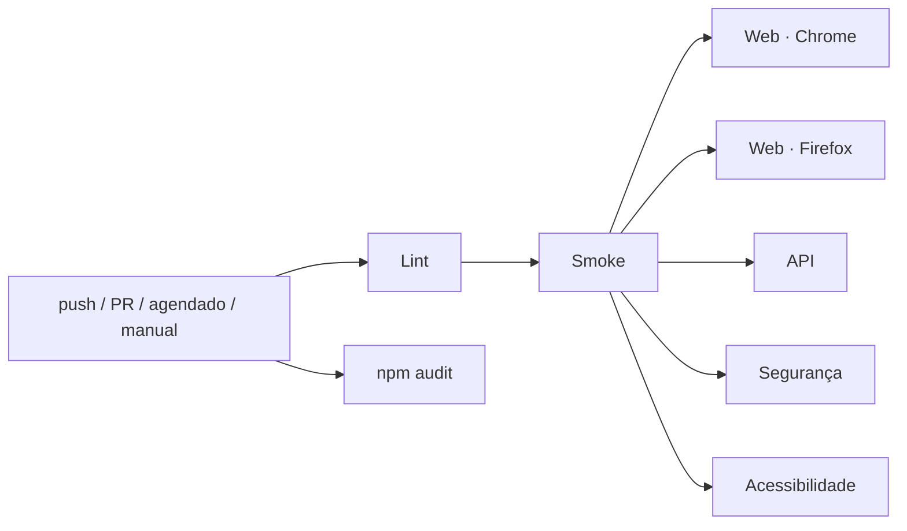

# Cypress QA Portfolio

[](https://github.com/<seu-usuario>/cypress-qa-portfolio/actions/workflows/ci.yml)


Projeto de automação de testes com **Cypress** cobrindo diferentes camadas e tipos de teste — **E2E web, API REST, contrato, acessibilidade e segurança** — com pipeline no **GitHub Actions**.

Autora: **Marcella Santos Cruz** — QA

---

## Sumário

- [Sites-alvo](#sites-alvo)
- [Tipos de teste](#tipos-de-teste)
- [Estrutura](#estrutura)
- [Como executar](#como-executar)
- [Tags](#tags)
- [Pipeline de CI](#pipeline-de-ci)
- [Achados de segurança](#achados-de-segurança)
- [Decisões técnicas](#decisões-técnicas)

## Sites-alvo

Ambientes públicos e gratuitos, criados para prática de testes:

| Alvo | Uso | URL |
|------|-----|-----|
| **SauceDemo** (Sauce Labs) | E2E web, acessibilidade, segurança web | https://www.saucedemo.com |
| **ServeRest** | API REST, contrato, segurança de API | https://serverest.dev |

## Tipos de teste

| Suite | O que cobre | Local | Testes |
|-------|-------------|-------|--------|
| **Web E2E** | Login, catálogo (ordenação), carrinho, checkout ponta a ponta, validação de formulários | `cypress/e2e/web` | 20 |
| **API REST** | Login, CRUD de usuários e produtos, regras de negócio, validação de payload, tempo de resposta | `cypress/e2e/api` | 23 |
| **Contrato** | JSON Schema (Ajv) para respostas de login, usuários e produtos | tag `@contract` | (incluídos na API) |
| **Segurança Web** | Controle de acesso, XSS, SQL Injection, HTTPS, auditoria de headers + 5 vulnerabilidades conhecidas | `cypress/e2e/security/web-*`, `transport-*` | 18 |
| **Segurança API** | 401/403, JWT adulterado / `alg:none` / usuário excluído, NoSQL/SQLi, mass assignment, vazamento de erros + 2 vulnerabilidades conhecidas | `cypress/e2e/security/api-*` | 24 |
| **Acessibilidade** | WCAG 2.1 A/AA com axe-core em 4 telas | `cypress/e2e/accessibility` | 4 |

**Total:** 89 testes.

As suites de segurança seguem o **OWASP Top 10 (2021)** e o **OWASP API Security Top 10 (2023)**. Todos os testes são **não destrutivos** (sem força bruta, sem carga, dados criados são removidos).

## Estrutura

```
cypress-qa-portfolio/
├── .github/
│   ├── workflows/ci.yml          # pipeline: lint → smoke → matriz de regressão
│   └── dependabot.yml
├── cypress/
│   ├── e2e/
│   │   ├── web/                  # E2E SauceDemo
│   │   ├── api/                  # API ServeRest + contrato
│   │   ├── security/             # suites de segurança web e API
│   │   └── accessibility/        # axe-core
│   ├── fixtures/
│   │   ├── web/                  # usuários e mensagens esperadas
│   │   ├── api/schemas/          # JSON Schemas (contrato)
│   │   └── security/             # payloads XSS / SQLi / NoSQL
│   └── support/
│       ├── pages/                # Page Objects
│       ├── commands/             # comandos customizados (ui, api, security, a11y)
│       ├── utils/jwt.js          # decodificar / forjar / adulterar JWT
│       └── factories.js          # massa de dados dinâmica (Faker)
├── docs/SECURITY-FINDINGS.md     # relatório dos achados de segurança
├── cypress.config.js
└── eslint.config.js
```

## Como executar

Pré-requisito: **Node.js 20+**.

```bash
npm install
```

```bash
npm run cy:open          # modo interativo
```

```bash
npm test                 # todas as suites
```

| Script | Descrição |
|--------|-----------|
| `npm run test:web` | E2E web |
| `npm run test:api` | API REST + contrato |
| `npm run test:security` | Segurança (web + API) |
| `npm run test:a11y` | Acessibilidade |
| `npm run test:smoke` | Apenas testes `@smoke` de todas as suites |
| `npm run test:known-vulns` | Apenas as vulnerabilidades conhecidas (`@known-vuln`) |
| `npm run api:local` | Sobe o ServeRest localmente na porta 3000 |
| `npm run lint` | ESLint com `eslint-plugin-cypress` |

Rodar uma spec específica ou em outro navegador:

```bash
npx cypress run --spec "cypress/e2e/web/checkout.cy.js"
```

```bash
npm run test:web -- --browser chrome
```

Relatório HTML (Mochawesome): `cypress/reports/html/index.html`.
Relatórios de auditoria de headers: `cypress/reports/security/*.json`.

### API local (recomendado para execuções repetidas)

A API pública `serverest.dev` tem proteção contra teste de carga e responde **HTTP 429** quando recebe muitas requisições seguidas (ex.: rodar a suíte completa várias vezes). Para evitar isso, suba o ServeRest localmente em um terminal:

```bash
npm run api:local
```

E aponte os testes para ele em outro terminal:

```bash
npx cypress run --expose apiUrl=http://localhost:3000
```

No CI isso já é feito automaticamente.

## Tags

Filtro com [`@cypress/grep`](https://github.com/cypress-io/cypress/tree/develop/npm/grep):

| Tag | Significado |
|-----|-------------|
| `@smoke` | Caminho crítico, roda primeiro no CI |
| `@regression` | Regressão funcional |
| `@web` / `@api` | Camada |
| `@security` | Testes de segurança |
| `@contract` | Validação de JSON Schema |
| `@a11y` | Acessibilidade |
| `@known-vuln` | Vulnerabilidade conhecida — o teste confirma que ela continua presente |

```bash
npx cypress run --expose grepTags="@security+@api"
```

## Pipeline de CI



- **Lint** e **auditoria de dependências** (SCA com `npm audit`) em paralelo.
- **Smoke** como portão: se o caminho crítico quebrar, a regressão nem roda.
- **Regressão em matriz**, com web em **Chrome e Firefox** (cross-browser) e `fail-fast: false`.
- **ServeRest local em cada job** (`start` + `wait-on` da action do Cypress): ambiente isolado, sem depender da disponibilidade nem do rate limit da API pública.
- Execução **agendada em dias úteis** para detectar mudanças nos sites-alvo.
- **Disparo manual** escolhendo a suite (`workflow_dispatch`).
- Relatórios e screenshots publicados como **artifacts**; resumo no **Job Summary**.
- `permissions: contents: read` (menor privilégio) e **Dependabot** para npm e actions.

## Achados de segurança

As suites identificaram **7 vulnerabilidades reais** nos alvos — entre elas, **senhas em texto puro dentro do JWT** e **expostas em `GET /usuarios`** (ServeRest), e **sessão forjável via cookie** (SauceDemo).

Cada vulnerabilidade tem um **teste de caracterização** (`@known-vuln`): ele **passa enquanto a falha continuar reproduzível**, servindo como evidência viva, e registra no log `[VULN-XXX] CONFIRMADA`. Se o site corrigir o problema, o teste quebra com uma mensagem pedindo para convertê-lo em teste de regressão do comportamento seguro.

Detalhes, evidências e recomendações: [docs/SECURITY-FINDINGS.md](docs/SECURITY-FINDINGS.md).

## Decisões técnicas

- **Page Objects** para a UI e **comandos customizados** para a API: specs legíveis, sem seletores espalhados.
- **Seletores `data-test`** — estáveis e independentes de estilo.
- **`cy.session`** com validação: login via UI executa uma vez por usuário e é reaproveitado entre specs.
- **Massa de dados dinâmica** com Faker e limpeza no `after()` — testes independentes e sem lixo na API pública.
- **Testes orientados a dados** (cenários em arrays) para validações e payloads.
- **Contrato com Ajv** + `ajv-formats`, schemas versionados em fixtures.
- **Acessibilidade em duas passadas**: loga todas as violações, falha só nas críticas.
- **`retries` só no `cypress run`** (2 tentativas) para absorver instabilidade de rede de serviços públicos, sem mascarar falhas no modo interativo.
- **Deep links do SauceDemo**: o site é uma SPA no GitHub Pages e responde **HTTP 404** em rotas internas (com script de fallback). O comando `cy.visitSpa` trata esse comportamento de forma explícita e documentada.
- **Cypress 15** (e não 16) porque `cypress-axe` ainda não declara suporte à v16 — evita `--legacy-peer-deps`.

## Licença

MIT
